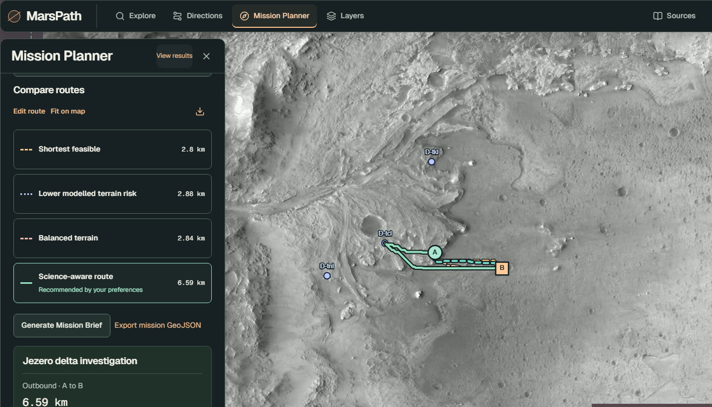
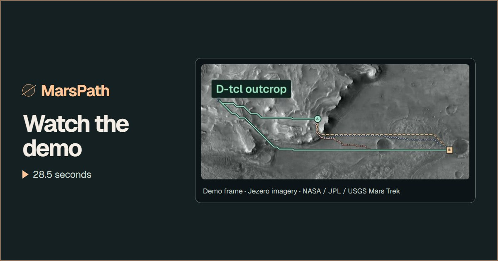

# MarsPath

**Plan science traverses on Mars.** Explore real orbital imagery, compare terrain-aware routes and bring the evidence into a mission brief.

[Open MarsPath](https://marspath-spaceapps-2026.vercel.app/) · [Watch the demo](https://marspath-spaceapps-2026.vercel.app/demo/) · [Try the Jezero mission](https://marspath-spaceapps-2026.vercel.app/?mission=jezero)



*Jezero Crater. Orbital imagery courtesy of NASA / JPL / USGS Mars Trek.*

## A route changes with the goal

Set a start, a destination and up to three waypoints. MarsPath uses elevation, slope and valid terrain coverage to calculate candidate routes. Compare their distance and modelled terrain costs, then add a science objective to see which candidate best fits the mission.

At Jezero, **Shortest** recommends **2.80 km** outbound. **Science first** recommends **6.59 km** and reaches a published delta outcrop. The solver compares the same four candidates in both views. The result helps you decide whether the science stop is worth the extra 3.78 km. [Stack et al. outcrop locations](https://pmc.ncbi.nlm.nih.gov/articles/PMC7116714/#Tab2)

[](https://marspath-spaceapps-2026.vercel.app/demo/)

## Explore and plan

- Browse 14 destinations and 42 individually credited images. NASA Mars Trek provides the live orbital imagery. The Space Apps challenge lists Mars Trek among its resources. [Official challenge resources](https://www.spaceappschallenge.org/2026/challenges/interplanetary-survival-guide-martian-map/?tab=resources)
- Compare regional CTX terrain at Jezero and Oxia with coarse 0.25° global MOLA terrain. View terrain resolution, coverage and unassessed connectors on the map.
- Inspect elevation, geology, mineral observations, apparent thermal inertia, modelled climate and radiation. Historical MEDA readings and fixed model scenarios are labelled separately.
- Plan a direct return leg, estimate geometric daylight and explore terrain line of sight from a hypothetical station. Save a browser-printable Mission Brief or export both legs and their provenance as mission GeoJSON.

[Sources and attribution](https://marspath-spaceapps-2026.vercel.app/sources/) · [Methodology and limitations](https://marspath-spaceapps-2026.vercel.app/methodology/) · [Independent validation](docs/VALIDATION.md)

## Run locally

Use Node.js and npm. The application uses Next.js App Router, React and OpenLayers. A cancellable TypeScript worker runs A* on fixed scientific rasters in the browser. Production is a static export on Vercel.

```sh
npm ci
npm run dev
```

To preview the static export locally:

```sh
npm run build
npm start
```

For local demo playback, place the two public MP4 renditions in a local directory and run `npm run stage:demo -- <rendition-directory>` after building. [Demo and rendition details](docs/SUBMISSION.md)

```sh
npm run typecheck
npm run lint
npm test
npx playwright install chromium webkit
npm run test:e2e -- --browser=chromium
npm run test:e2e -- --browser=webkit
```

## Scientific limits and credits

MarsPath is for research and education. Regional models leave rock-scale hazards and alignment accuracy unresolved. Global terrain uses a coarser grid. Daylight is geometric, line of sight assumes a terrain surface and antenna heights, and radiation describes one scenario. Archived observations and modelled fields carry their dates, coverage and assumptions.

Created by **MarsPath contributors** for the 2026 NASA Space Apps Challenge, *Interplanetary Survival Guide: Martian Map*. The original software uses the [MIT License](LICENSE). [Third-party notices](THIRD_PARTY_NOTICES.md) cover data, imagery, fonts, libraries and demo media separately.

We used OpenAI Codex to explore implementation and editorial options, research original sources, assist analysis and validation, code, write and design the interface, and produce the demo edit and synthesized audio. The atlas and video use genuine planetary imagery and mission data. MarsPath's routing and comparisons run deterministic algorithms. [AI assistance and science methods](https://marspath-spaceapps-2026.vercel.app/methodology/)
